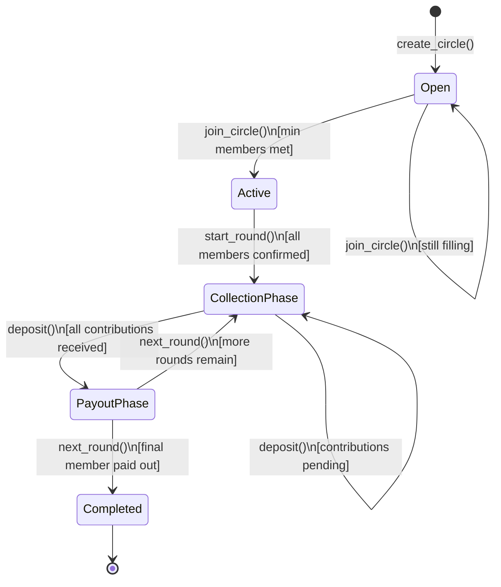

# SoroSusu: Decentralized Savings Circle

A trustless Rotating Savings and Credit Association (ROSCA) built on Stellar Soroban.

## Deployed Contract

- **Network:** Stellar Mainnet
- **Contract ID:** `CAH65U2KXQ34G7AT7QMWP6WUFYWAV6RPJRSDOB4KID6TP3OORS3BQHCX`

## Overview

SoroSusu is a smart contract protocol that implements the traditional African savings circle (Susu/ROSCA) on the Stellar blockchain. Members pool funds each round, and one member receives the full pot, rotating until every member has received a payout. The protocol enforces rules through code — no trust in a middleman is required.

## Features

- **Circle Management**: Create savings circles with fixed contribution amounts, max members, and configurable cycle durations
- **Secure Deposits**: Deposit USDC/XLM via Soroban token transfers with collateral verification for high-value circles
- **Insurance Fund**: Built-in insurance pool funded by per-contribution fees to cover defaults
- **Late Fee System**: Automatic penalties for late contributions with grace period support
- **Buddy System**: Pair members for mutual payment protection via safety deposits
- **Leniency Voting**: Democratic 48-hour grace period extensions through member voting
- **Quadratic Voting**: Wealth-mitigated governance for large groups (≥10 members)
- **Collateral Vault**: Lock collateral for high-value circles (≥1000 XLM total) with auto-slash on default
- **Rate-Limited Creation**: 5-minute cooldown between circle creations per address to prevent spam
- **NFT Membership**: Each member receives an NFT representing their circle membership
- **Randomized Payout Order**: Optional shuffling of payout queue for fairness
- **Multi-Cycle Rollover**: Reset and start new cycles with existing members

## Savings Group Lifecycle



## Setup & Installation

### Prerequisites

- [Rust](https://rustup.rs/) (stable toolchain)
- `wasm32-unknown-unknown` target: `rustup target add wasm32-unknown-unknown`

### Build

```bash
cargo build --target wasm32-unknown-unknown --release
```

### Test

```bash
cargo test
```

### Run Specific Test Suites

```bash
cargo test --test collateral_test
cargo test --test leniency_voting_test
cargo test --test quadratic_voting_test
cargo test --test rate_limit_test
cargo test --test buddy_system_test
cargo test --test hyper_inflation_test
cargo test --test pipeline_test
```

## Public Function Signatures

### Admin / Initialization

#### `initialize`
```rust
pub fn initialize(env: Env, admin: Address)
```
Initialises the contract and sets the admin address. Must be called once immediately after deployment.

#### `set_protocol_fee`
```rust
pub fn set_protocol_fee(env: Env, fee_basis_points: u32, treasury: Address)
```
Sets the protocol fee rate (basis points) and the treasury address. Admin-only. Capped at 10,000 (100%).

### Circle Management

#### `create_circle`
```rust
pub fn create_circle(
    env: Env,
    creator: Address,
    amount: i128,
    max_members: u32,
    token: Address,
    cycle_duration: u64,
    insurance_fee_bps: u32,
    nft_contract: Address,
) -> u64
```
Creates a new savings circle. Returns the new `circle_id`. Enforces 5-minute rate limit per creator.

#### `join_circle`
```rust
pub fn join_circle(env: Env, user: Address, circle_id: u64, tier_multiplier: u32, referrer: Option<Address>)
```
Adds a member to an existing circle. Verifies collateral requirement for high-value circles.

### Round Operations

#### `deposit`
```rust
pub fn deposit(env: Env, user: Address, circle_id: u64)
```
Records a member's contribution for the current round. Applies late fees after deadline (respecting grace periods). Includes buddy system fallback.

#### `finalize_round`
```rust
pub fn finalize_round(env: Env, caller: Address, circle_id: u64)
```
Finalizes the round after all members have contributed. Admin or circle creator only.

#### `claim_pot`
```rust
pub fn claim_pot(env: Env, user: Address, circle_id: u64)
```
Transfers the pooled funds to the designated recipient. Auto-releases collateral upon completion.

### Collateral System

#### `stake_collateral`
```rust
pub fn stake_collateral(env: Env, user: Address, circle_id: u64, amount: i128)
```
Locks collateral before joining a high-value circle. Minimum 20% of total cycle value.

#### `slash_collateral`
```rust
pub fn slash_collateral(env: Env, caller: Address, circle_id: u64, member: Address)
```
Confiscates collateral from defaulted members. Admin/creator only.

#### `release_collateral`
```rust
pub fn release_collateral(env: Env, caller: Address, circle_id: u64, member: Address)
```
Returns collateral after all contributions are completed.

#### `mark_member_defaulted`
```rust
pub fn mark_member_defaulted(env: Env, caller: Address, circle_id: u64, member: Address)
```
Marks a member as defaulted and auto-slashes their collateral.

### Buddy System

#### `pair_with_member`
```rust
pub fn pair_with_member(env: Env, user: Address, buddy_address: Address)
```
Pairs two members for mutual payment protection.

#### `set_safety_deposit`
```rust
pub fn set_safety_deposit(env: Env, user: Address, circle_id: u64, amount: i128)
```
Deposits tokens as safety backup for your buddy.

### Leniency Voting

#### `request_leniency`
```rust
pub fn request_leniency(env: Env, requester: Address, circle_id: u64, reason: String)
```
Initiates a 48-hour grace period extension request. 24-hour voting period follows.

#### `vote_on_leniency`
```rust
pub fn vote_on_leniency(env: Env, voter: Address, circle_id: u64, requester: Address, vote: LeniencyVote)
```
Casts an approve/reject vote. Auto-finalizes when majority reached.

#### `finalize_leniency_vote`
```rust
pub fn finalize_leniency_vote(env: Env, caller: Address, circle_id: u64, requester: Address)
```
Finalizes voting after the 24-hour deadline expires.

### Quadratic Voting (Large Groups ≥10 members)

#### `create_proposal`
```rust
pub fn create_proposal(
    env: Env,
    proposer: Address,
    circle_id: u64,
    proposal_type: ProposalType,
    title: String,
    description: String,
    execution_data: String,
) -> u64
```
Creates a governance proposal with 7-day voting period.

#### `quadratic_vote`
```rust
pub fn quadratic_vote(env: Env, voter: Address, proposal_id: u64, vote_weight: u32, vote_choice: QuadraticVoteChoice)
```
Casts a vote. Cost = weight². 60% supermajority required. 40% quorum.

#### `execute_proposal`
```rust
pub fn execute_proposal(env: Env, caller: Address, proposal_id: u64)
```
Finalizes and executes approved proposals.

### Query Functions

| Function | Returns |
|---|---|
| `get_circle(circle_id)` | Full circle state |
| `get_members(circle_id)` | List of member addresses |
| `get_contribution_status(circle_id)` | Map of member → deposited status |
| `get_leniency_request(circle_id, requester)` | Leniency request details |
| `get_social_capital(member, circle_id)` | Social capital metrics |
| `get_leniency_stats(circle_id)` | Leniency statistics |
| `get_proposal(proposal_id)` | Proposal details |
| `get_voting_power(member, circle_id)` | Quadratic voting power |
| `get_proposal_stats(circle_id)` | Proposal statistics |

## Error Reference

| Code | Variant | Description |
|---|---|---|
| 1 | `Unauthorized` | Caller is not permitted to perform this action |
| 2 | `MemberNotFound` | Member does not exist |
| 3 | `CircleFull` | Circle has reached maximum members |
| 4 | `AlreadyMember` | Member is already in this circle |
| 5 | `CircleNotFound` | No circle exists with the given ID |
| 6 | `InvalidAmount` | Invalid contribution amount |
| 7 | `RoundAlreadyFinalized` | Round has already been finalized |
| 8 | `RoundNotFinalized` | Round has not been finalized yet |
| 9 | `NotAllContributed` | Not all members have contributed |
| 10 | `PayoutNotScheduled` | Payout has not been scheduled |
| 11 | `PayoutTooEarly` | Payout window has not opened yet |
| 12 | `InsufficientInsurance` | Insurance balance insufficient |
| 13 | `InsuranceAlreadyUsed` | Insurance already used this round |
| 14 | `RateLimitExceeded` | Must wait 5 minutes between circle creations |
| 15 | `InsufficientCollateral` | Collateral amount too low |
| 16 | `CollateralAlreadyStaked` | Collateral already locked |
| 17 | `CollateralNotStaked` | No collateral found |
| 18 | `CollateralLocked` | Collateral is currently locked |
| 19 | `MemberNotDefaulted` | Member is not in defaulted state |
| 20 | `CollateralAlreadyReleased` | Collateral already returned |
| 21 | `LeniencyRequestNotFound` | No leniency request found |
| 22 | `AlreadyVoted` | Member has already voted |
| 23 | `VotingPeriodExpired` | Voting period has ended |
| 24 | `LeniencyAlreadyApproved` | Leniency already granted |
| 25 | `LeniencyNotRequested` | No leniency request pending |
| 26 | `CannotVoteForOwnRequest` | Self-voting not allowed |
| 27 | `InvalidVote` | Invalid vote choice |
| 28 | `ProposalNotFound` | No proposal found |
| 29 | `ProposalAlreadyExecuted` | Proposal already executed |
| 30 | `VotingNotActive` | Voting is not active |
| 31 | `InsufficientVotingPower` | Not enough voting power |
| 32 | `QuadraticVoteExceeded` | Vote weight exceeds maximum |
| 33 | `InvalidProposalType` | Invalid proposal type |
| 34 | `QuorumNotMet` | Quorum not reached |
| 35 | `ProposalExpired` | Proposal has expired |

## Security Considerations

- **Authorization**: All state-changing operations require `require_auth()`
- **Rate Limiting**: 5-minute cooldown between circle creations per address
- **Collateral Enforcement**: High-value circles (≥1000 XLM) require 20% collateral
- **Checked Arithmetic**: All volume calculations use checked operations to prevent overflow
- **State Validation**: Strict status transitions prevent invalid state changes
- **Double-Use Prevention**: Members cannot join twice, vote twice, or claim twice

## License

MIT
